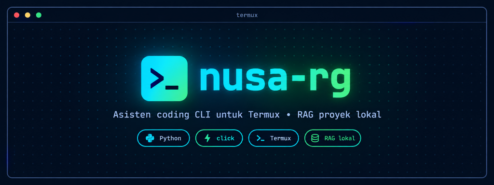

# NUSA-RG



Asisten pemrograman untuk terminal Termux di Android. Alat ini mengindeks
sebuah proyek dengan SQLite FTS5, menyisipkan potongan kode yang paling
relevan ke dalam prompt bersama pertanyaan Anda, lalu menjawab lewat API
berprotokol OpenAI atau model llama.cpp lokal. Semuanya berjalan di dalam
terminal: tanpa server, tanpa browser, tanpa GUI.

Keluaran sungguhan, dari indeks sungguhan dan penyedia yang disimulasikan:

```
nusa-rg 1.3.0
session 20261021-023855-97a9 · 0 turn(s) · resume: nusa-rg chat --session 20261021-023855-97a9
retrieved 1 snippet(s) in 0.01s
context src/auth.py:1-13
    import hashlib
    import hmac
    import os
    ...
    def verify_password(password: str, salt: bytes, digest: bytes) -> bool:
        """Constant-time password check."""
    ... (+1 more lines)

The check lives in src/auth.py:12. verify_password() compares the digest with hmac.compare_digest.
```

Spesifikasinya ada di [AGENS.md](AGENS.md), juga berbahasa Indonesia. Dokumen
ini adalah versi Indonesia; versi Inggris ada di [README.md](README.md).

## Kebutuhan

| | |
| :-- | :-- |
| Platform | Android dengan Termux 0.118 atau lebih baru, ARM64 |
| Python | 3.10 atau lebih baru |
| Indeks | SQLite dengan FTS5, sudah termasuk dalam CPython |
| Opsional | `llama-cli` dan model GGUF, untuk menjawab tanpa jaringan |
| Opsional | [rtk](https://github.com/rtk-ai/rtk), untuk memampatkan keluaran perintah |

`nusa-rg doctor` memeriksa platform, izin berkas, keystore, katalog
provider, indeks, dan model lokal.

## Pemasangan

```bash
git clone https://github.com/padz24/Nusa-rg.git ~/nusa-rg
cd ~/nusa-rg && ./install.sh
```

Skrip pemasangan memeriksa arsitektur dan versi Termux, memasang dua modul
yang tidak punya wheel Android di PyPI (`cryptography` dan `PyYAML`),
memasang paketnya, dan bisa membangun llama.cpp untuk jalur lokal.

Dari repositori Termux, setelah diterbitkan:

```bash
pkg install termux-nusa-rg
```

## Mulai cepat

```bash
nusa-rg config set api_key --secret      # terenkripsi, tidak pernah ditulis ke config.yaml
nusa-rg index ~/projects/my-app
nusa-rg chat
nusa-rg chat "explain this traceback"    # satu pertanyaan, lalu keluar
```

## Perintah

| Perintah | Fungsinya |
| :-- | :-- |
| `nusa-rg chat` | Sesi interaktif: `/exit`, `/clear`, `/session`, `/caveman`, `!command`, `/help` |
| `nusa-rg chat "msg"` | Satu pertanyaan, lalu keluar |
| `nusa-rg chat --session <id>` | Melanjutkan percakapan tersimpan |
| `nusa-rg session list` | Percakapan tersimpan, terbaru lebih dulu |
| `nusa-rg session show <id>` | Metadata dan isi percakapan satu sesi |
| `nusa-rg session new [id]` | Membuat sesi dan mencetak id-nya |
| `nusa-rg session delete <id> --yes` | Menghapus sesi |
| `nusa-rg run <cmd>` | Menjalankan perintah; `--ask "…"` menjawab memakai keluarannya sebagai konteks |
| `nusa-rg index <path>` | Memindai dan mengindeks sebuah proyek |
| `nusa-rg providers list` | Katalog bawaan berisi 232 provider |
| `nusa-rg providers show <id>` | Endpoint, variabel kunci, model bawaan |
| `nusa-rg providers models <id>` | Model yang tersedia di sebuah provider |
| `nusa-rg providers icon <id>` | Menggambar logo satu provider |
| `nusa-rg providers refresh` | Mengambil katalog baru dari models.dev |
| `nusa-rg config show` | Konfigurasi yang sedang aktif |
| `nusa-rg config set <key> <value>` | Mengubah pengaturan (`--secret` untuk kunci, `--provider <id>` per provider) |
| `nusa-rg config path` | Letak berkas-berkas state |
| `nusa-rg status` | Provider, model, gaya, rantai fallback, indeks, konektivitas |
| `nusa-rg update` | Memperbarui checkout sumber ke rilis terbaru |
| `nusa-rg doctor` | Pemeriksaan pemasangan dan keamanan |

Flag yang perlu diketahui: `--project/-p`, `--no-rag`, `--stream`/`--no-stream`,
`--session`/`--session-id`, `--caveman`, `--json` pada `index`, `--force` pada
`index`, `--reveal` pada `config show`, `--raw` pada `run`.

## Cara retrieval bekerja

1. Pemindai menelusuri proyek dan melewati berkas biner, direktori tersembunyi,
   `node_modules`, `.venv`, serta berkas yang lebih besar dari
   `max_file_bytes` (2 MB).
2. Pembangun indeks memecah berkas menjadi potongan berukuran `chunk_lines`
   (60) dengan tumpang tindih `chunk_overlap_lines` (10), lalu menuliskannya ke
   SQLite FTS5 dengan tokenizer `unicode61 remove_diacritics 2`. Berkas yang
   tidak berubah dilewati berdasarkan mtime, sehingga pengindeksan ulang
   inexpensive.
3. Pengambil melakukan kueri FTS5, memberi peringkat dengan BM25, dan
   mempertahankan `max_context_snippets` (3) hasil teratas.
4. Penyusun membungkus potongan itu dengan pembatas, melabeli tiap potongan
   sebagai `path:line`, lalu menambahkan pertanyaan Anda.

Spesifikasi menuntut retrieval di bawah dua detik untuk proyek 50 MB
(AC-03). Langkah retrieval pada transkrip di atas memakan 0,01 detik; yang
memakan waktu adalah panggilan ke model.

## Sesi percakapan

Setiap chat menyimpan satu sesi. Tanpa `--session`, `nusa-rg chat` memulai
sesi sendiri, mencetak detailnya, dan menyimpan tiap giliran saat terjadi:

```text
  session    20261021-010019-2144
  turns      0
  project    /home/user/projects/my-app
  stored     /home/user/.nusa-rg/sessions/20261021-010019-2144.json
resume with: nusa-rg chat --session 20261021-010019-2144
```

Blok yang sama dicetak lagi saat sesi berakhir, sehingga id dan perintah
untuk melanjutkan percakapan itu ada di tangan saat Anda keluar.

```bash
nusa-rg chat --session fix-auth
nusa-rg chat --session fix-auth "lalu kenapa itu terjadi?"
nusa-rg run --session fix-auth --ask "apa yang gagal?" pytest -x
```

Di dalam chat:

```
/session [show [id]]        menampilkan sesi aktif atau sesi tertentu
/session list               mendaftar sesi tersimpan
/session new [id]           memulai sesi baru, id dibuat bila tidak disebut
/session use <id>           beralih ke sesi tersimpan
/session delete <id> --yes  menghapus satu sesi
```

Sesi disimpan di `~/.nusa-rg/sessions/<id>.json` dengan mode 0600. Hanya
percakapan dan gaya jawaban yang disimpan; kode yang diambil dari indeks
dibangun ulang pada setiap giliran. Prompt membawa `session_history_turns`
giliran terakhir (10 secara bawaan), sedangkan berkasnya menyimpan seluruh
transkrip. `/clear` mengosongkan riwayat sesi yang sedang berjalan.

## Provider

Katalog bawaan adalah cuplikan terpotong dari [models.dev](https://models.dev):
232 provider dan 8.602 model, dan 209 di antaranya berbicara protocol
chat-completions OpenAI sehingga siap pakai hanya dengan satu kunci.

```bash
nusa-rg providers list
nusa-rg providers list --search deep
nusa-rg providers show deepseek
nusa-rg providers models deepseek
nusa-rg providers icon deepseek
nusa-rg providers refresh
```

Setiap provider punya logo di registry, dan `providers list` menggambarnya di
samping entri. Terminal tidak bisa menampilkan SVG, jadi berkasnya diraster
menjadi sel Braille. Tiap entri mendapat warnanya sendiri, ditentukan dari id
provider, dan satu baris kosong memisahkan entri satu sama lain:

```text
  ⢀⣴⣾⣿⣿⣶⣄⠀  [ok] 302ai
  ⣾⣿⣿⣿⣿⣿⣿⣧  302.AI
  ⢻⣿⣿⣿⣿⣿⣿⡿  122 models
  ⠀⠙⠿⣿⣿⡿⠟⠁  key 302AI_API_KEY

  ⠀⢀⠀⡄⢠⠀⡀⠀  [ok] abacus
  ⠀⠸⠀⠆⢸⠀⣃⠀  Abacus
  ⠀⢙⠀⡇⠰⠀⡅⠀  103 models
  ⠀⠈⠀⠃⠘⠀⠁⠀  key ABACUS_API_KEY
```

SVG-nya diambil sekali lalu disimpan di `~/.nusa-rg/logos`. `providers list
--no-icons`, atau variabel lingkungan `NUSA_RG_NO_LOGOS=1`, mempertahankan
tabel ringkas satu baris dan tidak pernah menyentuh jaringan. Hal yang sama
terjadi ketika models.dev tidak dapat dihubungi.

Berpindah provider adalah perubahan konfigurasi dan berlaku pada giliran
berikutnya. Memilih provider juga memilih model bawaannya, yang bisa
diubah dengan `config set api_model`:

```bash
nusa-rg config set provider deepseek
nusa-rg config set provider local
nusa-rg config set local_model_path ~/models/qwen2.5-coder-7b-q4_k_m.gguf
nusa-rg config set local_llama_bin ~/llama.cpp/build/bin/llama-cli
```

Kunci bisa datang dari variabel lingkungan yang dicatat models.dev untuk
provider tersebut, atau dari keystore terenkripsi, disimpan per provider:

```bash
export GROQ_API_KEY=...
nusa-rg config set api_key --provider groq --secret
```

Urutan pencarian adalah entri keystore per provider, lalu variabel
lingkungan provider itu, lalu slot `api_key` bersama. `status` menampilkan
status kunci provider yang aktif, dan `doctor` mendaftar seluruh referensi
per provider.

Semua endpoint yang kompatibel dengan OpenAI tetap bisa dipakai dengan
`api_base_url` yang diisi manual. Sepuluh provider yang URL dasarnya
diserahkan models.dev ke SDK masing-masing (OpenAI, Groq, Mistral,
Perplexity, xAI, Cerebras, DeepInfra, Together, AIHubMix, Venice) sudah
punya endpoint bawaan.

### Failover

`fallback_providers` berupa daftar, dan rantainya dicoba berurutan, sehingga
rate limit atau padam layanan tidak lagi mengakhiri giliran:

```bash
nusa-rg config set fallback_providers "groq, deepseek:deepseek-flash"
```

Entri berbentuk `id` atau `id:model`. Fallback tanpa kunci, tanpa model,
atau tanpa endpoint yang kompatibel dengan OpenAI dilewati, alasannya
dicatat sebagai `llm.chain.skip`, dan `doctor` melaporkannya. Ketika
fallback menjawab, giliran itu menyebutkan provider yang menjawab, dan
`status` mencetak seluruh rantainya.

Dua catatan/provider:

- Sebagian model, termasuk `beam` dari Ollama, memakai awal anggaran token
  untuk berpikir dan bisa mengembalikan jawaban kosong ketika anggaran itu
  habis. `nusa-rg` melaporkan hal itu beserta sebagian hasil berpikirnya,
  bukan menampilkan jawaban kosong. Naikkan batasnya dengan `nusa-rg config
  set max_tokens 4096`.
- Ollama Cloud tidak ada di models.dev. Tunjuk langsung dengan `nusa-rg config
  set api_base_url https://ollama.com/v1`.

## Menjalankan perintah

`nusa-rg run` menjalankan sebuah perintah dan, dengan `--ask`, menjawab
pertanyaan memakai keluarannya sebagai konteks:

```bash
nusa-rg run git status
nusa-rg run --ask "apa yang rusak?" pytest -x
nusa-rg run --raw npm install
```

Di dalam chat, baris yang diawali `!` melakukan hal yang sama:

```
❯ !pytest -x
  $ pytest -x
  in /home/user/projects/my-app
  ... output ...
  exit 1 | 2.4s
❯ kenapa tes kedua gagal?
```

Aturannya:

- Perintah berjalan hanya ketika Anda mengetiknya. Jawaban dari model
  tidak pernah bisa memulai perintah.
- Perintah berjalan di proyek yang terindeks, bukan di direktori tempat
  asisten dijalankan. Direktorinya dicetak di atas keluaran, dan `--project`
  pada `run` mengoverride-nya.
- Tidak ada yang melewati shell. `;`, `|`, `&`, backtick, `$`, `<`, `>` dan
  baris baru ditolak dengan penjelasan. Pakai terminal sungguhan untuk
  pipeline.
- `command_timeout` (120 detik) dan `command_output_limit` (40.000 byte)
  membatasi jalannya, dan `--timeout` pada `run` mengoverride batas waktu
  untuk satu pemanggilan.
- `run` keluar dengan kode keluar perintah itu sendiri, jadi bisa dirangkai
  dengan skrip. Dengan `--ask`, perintah yang gagal berubah menjadi
  penjelasan, bukan stack trace yang harus Anda jelaskan sendiri.

Ketika [rtk](https://github.com/rtk-ai/rtk) (Rust Token Killer) terpasang,
`nusa-rg run` menjalankan perintah sebagai `rtk <command>` dan RTK menulis
ulang keluarannya sebelum sampai ke model. Batas byte berlaku dengan maupun
tanpa rtk, jadi satu perintah yang berisik tidak dapat menghabiskan jendela
konteks. `nusa-rg doctor` memberi tahu apakah rtk terpasang.

## Caveman

`response_style: caveman` menambahkan aturan ringkas ke system prompt:
buang kata sandang, pengisi, basa-basi, dan keraguan; awali dengan
jawabannya; kalimat terpotong tidak masalah. Kode, path, angka, identifier,
dan pesan error tetap apa adanya. Ini gaya di tingkat prompt, jadi bekerja
di setiap provider, eksternal maupun lokal, dan tidak memerlukan plugin.

```bash
nusa-rg config set response_style caveman     # permanen
nusa-rg chat --caveman                        # untuk sesi ini
nusa-rg chat --caveman "explain this traceback"
nusa-rg run --caveman --ask "apa yang berubah?" git diff
```

Di dalam sesi, `/caveman` menyalakan dan mematikan gaya, dan
`/caveman on|off` menetapkannya. `status` menampilkan gaya yang aktif.

## Konfigurasi

`~/.nusa-rg/config.yaml`, dibuat otomatis pada pemakaian pertama. Nilai
bawaannya:

```yaml
model_provider: external        # external | local
api_provider: ''                # id katalog di balik api_base_url
api_base_url: https://api.openai.com/v1
api_model: gpt-4o-mini
api_key: ''                     # referensi keystore:// setelah tersimpan
provider_keys: {}               # referensi per provider
fallback_providers: []          # dicoba berurutan
local_model_path: ''
local_llama_bin: llama-cli
default_project_path: ''
response_style: default         # default | caveman
session_history_turns: 10
max_context_snippets: 3
chunk_lines: 60
chunk_overlap_lines: 10
max_file_bytes: 2097152
ignore_dirs: ['.git', 'node_modules', '__pycache__', '.venv', 'venv', 'build', 'dist', '.mypy_cache', '.pytest_cache']
ignore_globs: ['*.min.js', '*.lock', '*.so', '*.png', '*.jpg', '*.zip']
request_timeout: 60
max_tokens: null                # kosong berarti bawaan provider
temperature: 0.2
command_timeout: 120
command_output_limit: 40000
command_use_rtk: true
update_remote: ''               # kosong mempertahankan penjaga update khusus GitHub
log_level: INFO
system_prompt: 'You are a concise programming assistant embedded in a Termux terminal...'
```

### Pembaruan luring jaringan

`nusa-rg update` menolak remote selain repositori resmi
(`https://github.com/padz24/Nusa-rg`), karena pembaruan menjalankan
`git reset --hard` pada `origin`. Checkout yang masih menunjuk URL lama
`PADZ-PRD/RAG-termux-cli` juga diterima. Untuk pembaruan dari mirror lokal
atau repositori bare luring jaringan, sebutkan remote itu:

```bash
nusa-rg config set update_remote ~/RAG-termux-cli.git
```

Pengaturan itulah otorisasinya. Membiarkannya kosong mempertahankan
penjaga itu, sehingga `origin` yang salah tidak bisa memenuhi syaratnya
sendiri. Bila remote tidak punya tag rilis, pembaruan membandingkan commit
cabang remote dengan `HEAD` lokal.

## Pembaruan versi

```bash
nusa-rg update --check     # hanya melaporkan apakah ada versi baru
nusa-rg update             # pembaruan, lalu jalankan install.sh lagi
nusa-rg update --force     # buang commit lokal lebih dulu
```

`/update` di dalam chat melakukan hal yang sama. Konfigurasi, kredensial, dan
indeks tinggal di `~/.nusa-rg` dan tidak pernah disentuh, sehingga kunci dan
riwayat bertahan.

Dua kasus dilaporkan, bukan ditebak:

- Salinan yang dipasang dari repositori Termux tidak punya checkout untuk
  diperbarui. Perintahnya naik kelas dan menunjuk ke `pkg upgrade
  termux-nusa-rg`.
- Checkout yang `origin`-nya bukan repositori resmi ditolak, dan direktori
  `.git` milik proyek lain tidak pernah disalahartikan sebagai proyek ini.

Working tree yang kotor atau cabang yang bercabang menghentikan
pembaruan. `--force` membuang commit lokal dengan sengaja.

## Keamanan

| Jaminan | Cara dijamin |
| :-- | :-- |
| Tidak ada kredensial polos | Kunci disegel dengan AES-256-GCM di `~/.nusa-rg/keystore.bin`, dan `config.yaml` hanya menyimpan referensi `keystore://` |
| Bukti manipulasi | Alias menjadi associated data AEAD, sehingga entri yang diganti namanya atau diedit gagal autentikasi |
| Kueri dan kode tidak masuk log | Satu catatan log berisi `timestamp \| level \| event \| sha256(query)` |
| Token tidak bocor | Setiap baris log melewati penyaring: `sk-…`, `Bearer …`, dan private key menjadi `***MASKED***` |
| Berkas dibatasi | `config.yaml`, `index.db`, `keystore.bin`, dan log ber-mode `0600`, direktori state `0700` |
| Tidak ada injeksi shell | Tidak ada yang melewati shell, dan argumen disaring lalu dijalankan sebagai daftar |
| Perintah hanya jalan bila diketik | `run` dan `!command` hanya menjalankan baris perintah yang Anda ketik |
| Keluaran perintah terbatas | Keluaran dibatasi byte dengan bagian atas dan bawah kept, lalu ditandai dan disanitasi sebagai tidak tepercaya saat masuk prompt |
| Penguatan terhadap prompt injection | Penanda peran, pembatas milik sendiri, dan frasa pengoverride di berkas terindeks atau keluaran perintah dinetralkan |

Spesifikasi menyebut `termux-keystore` dan `termux-crypto`, yang belum
diterbitkan sebagai paket Termux. Implementasi ini memakai pustaka
`cryptography` untuk AES-256-GCM dan menyimpan master key di berkas `0600` di
dalam sandbox aplikasi Android. Keystore sungguhan bisa menggantinya di
belakang `nusa_rg/crypto.py` tanpa menyentuh bagian lain.

Semua state tinggal di satu direktori:

```
~/.nusa-rg/
├── config.yaml        # pengaturan; hanya referensi keystore
├── keystore.bin       # kredensial tersegel AES-256-GCM
├── master.key         # 0600, menurunkan kunci keystore lewat scrypt
├── index.db           # indeks SQLite FTS5
├── catalog.json       # opsional: cuplikan `providers refresh` (0600)
├── sessions/          # percakapan tersimpan
├── logos/             # SVG provider dari models.dev
└── logs/
    ├── app.log        # log operasional, rotasi 10 MB x 5
    └── audit.log      # perubahan konfigurasi dan operasi indeks
```

`NUSA_RG_HOME` memindahkan semuanya.

## Markdown

Jawaban dirender untuk terminal: blok kode menjadi panel berwarna sintaks,
tabel menjadi kisi berbingkai, dan daftar, daftar tugas, serta catatan kaki
mendapat penandanya.

```
Password Hashing
════════════════

┌───────────┬────────┬────────┐
│ Approach  │ Speed  │ Memory │
├───────────┼────────┼────────┤
│ PBKDF2    │  slow  │   low  │
└───────────┴────────┴────────┘

☑ Use a random salt per user
☐ Never store plaintext
```

Penguraian Markdown diserahkan ke
[`markdown2`](https://github.com/trentm/python-markdown2), bukan regex yang
ditulis sendiri. Parser buatan sendiri adalah banyak kode yang subtly salah;
saat pengembangan, parser itu salah menangani garis bawah di tengah kata,
fence yang tidak ditutup, dan blockquote bersarang, yang mudah terlewat.
`markdown2` hadir sebagai roda universal pure-Python, jadi terpasang di
Termux tanpa kompilator, berbeda dengan `cryptography` atau `PyYAML`, dan
diimpor secara lazy sehingga `--help` dan `status` tidak pernah menanggung
biayanya.

Proyek ini menangani hal yang tidak disediakan `markdown2`:
renderer HTML-ke-ANSI, tata letak dan pemotongan tabel, pewarnaan sintaks,
dan empat konstruksi yang dilewatkan markdown2 (subscript, superscript,
`==highlight==`, dan shortcode emoji), yang diterapkan di luar wilayah kode.

`nusa-rg chat --plain "..."` mencetak Markdown mentah sebagai gantinya.

## Arsitektur

```
CLI (click)
  ├── Command runner ──────→ rtk (optional) → process, never a shell
  ├── Catalogue (models.dev snapshot) → provider browser, failover wiring
  ├── Logo renderer (models.dev SVG → Braille cells) → provider browser
  └── CoreEngine ──────────────────┐
        ├── RAG Module            │
        │     scanner → index → retriever → composer
        └── LLM Client (swappable)
              ├── FailoverClient  → ordered chain of providers
              │     └── ApiClient → any OpenAI-compatible endpoint
              └── LocalLLMRunner → llama.cpp + GGUF
```

Modul RAG dan klien LLM bertemu hanya di dalam `CoreEngine`, jadi mengganti
satu tidak mengganggu yang lain. Itulah yang membuat berpindah provider
menjadi perubahan konfigurasi. Command runner sengaja berada di luar
`CoreEngine`: perintah hanya jalan dari masukan eksplisit pengguna, dan
engine hanya pernah menerima teks hasilnya sebagai konteks yang diberi label
dan sudah disanitasi.

## Pengembangan

```bash
pip install -e '.[dev]'
pytest                    # 613 tes
python -m nusa_rg         # jalan tanpa memasang
```

Suite tidak butuh jaringan dan tidak butuh API key: panggilan HTTP
disimulasikan dan jalur llama.cpp diuji dengan executable palsu.

## Pemecahan masalah

| Gejala | Perbaikan |
| :-- | :-- |
| `no API key configured` | `nusa-rg config set api_key --secret` |
| `no API key for provider 'x'` | `nusa-rg config set api_key --provider x --secret`, atau ekspor variabel lingkungan provider itu (`providers show x`) |
| `unknown provider` | Cari id-nya dengan `nusa-rg providers list --search <text>` |
| Katalog provider tidak terbaca | `nusa-rg providers refresh` mengganti cuplikan |
| `llama.cpp binary not found` | Bangun llama.cpp, atau set `local_llama_bin` ke path lengkapnya |
| `local model not found` | Pastikan `local_model_path` menunjuk berkas `.gguf` |
| Tidak ada snippet yang diambil | Jalankan ulang `nusa-rg index <path>`, dan periksa berkasnya terhadap `ignore_globs` dan `ignore_dirs` |
| Retrieval terasa lambat | `nusa-rg index --force` membangun ulang indeks yang basi |
| Jawaban mengabaikan proyek Anda | Set `default_project_path`, atau berikan `--project` |
| Operator shell ditolak | `run` dan `!command` menolak `;`, `\|`, `&`, backtick, `$`, `<`, `>` dan baris baru dengan sengaja |
| Keluaran perintah terpotong | Naikkan `command_output_limit`, atau biarkan rtk memotong lebih dulu |
| Jawaban terlalu mahal | `nusa-rg config set response_style caveman`, dan pasang rtk |
| Jawaban datang dari provider lain | `status` mencetak rantai fallback, dan giliran itu menyebut provider yang menjawab |

## Lisensi

MIT. Lihat [LICENSE](LICENSE).
